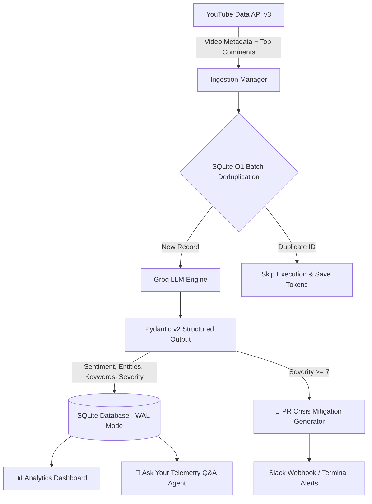

# Brand Sentiment & Crisis Monitoring Dashboard


An automated, event-driven brand intelligence and crisis monitoring platform. The system ingests social telemetry and user comment threads, performs structured sentiment analysis and open-ended topic discovery using high-throughput LLMs via the Groq API, persists optimized telemetry in SQLite, and provides interactive analytics alongside an AI-powered telemetry Q&A agent.

---

## Architecture Overview



---

## Key Features

* **Multi-Source Video & Comment Ingestion:** Collects video titles, descriptions, and top public comment threads using YouTube Data API v3 to capture true user sentiment beyond creator titles.
* **Dynamic Open-Ended Taxonomy:** Eliminates hardcoded category limits. The LLM dynamically discovers operational categories, sub-tags, named entities (brands, competitors, individuals), and key operational keywords.
* **High-Performance SQLite Storage:** Engineered with Write-Ahead Logging (WAL) for non-blocking concurrent reads/writes, explicit index strategies, native JSON array storage, and batch $O(1)$ deduplication checks.
* **"Ask Your Telemetry" AI Q&A Agent:** Interactive natural language synthesis tab allowing brand managers to query stored telemetry (e.g., *"What are the top user complaints this week?"*) with structured bullet insights.
* **Automated PR Crisis Engine:** Detects high-risk records ($\ge 7/10$ severity) and automatically drafts executive PR mitigation responses with webhook alerts.

---

## Tech Stack

| Component | Technology |
| :--- | :--- |
| **Language** | Python 3.11+ |
| **Frontend / Dashboard** | Streamlit, Plotly Express |
| **LLM Inference** | OpenAI Python SDK (configured for Groq API `openai/gpt-oss-20b`) |
| **Data Contracts** | Pydantic v2 |
| **Database & ORM** | SQLite (WAL Mode), SQLAlchemy |
| **Ingestion API** | Google API Python Client (`google-api-python-client`) |
| **Settings Management** | `pydantic-settings`, `python-dotenv` |

---

## Directory Structure

```text
brand-sentiment-monitor/
├── config/
│   └── settings.py          # Environment settings & validation
├── src/
│   ├── agents/
│   │   ├── schemas.py       # Pydantic v2 dynamic output schemas
│   │   ├── sentiment_agent.py # Groq sentiment & entity classifier
│   │   ├── response_agent.py  # PR crisis mitigation draft engine
│   │   └── qna_agent.py       # Telemetry Q&A synthesis agent
│   ├── alerts/
│   │   └── webhook_notifier.py # Slack notification webhook
│   ├── database/
│   │   ├── connection.py    # Database engine & WAL pragma configuration
│   │   └── models.py        # SQLAlchemy Indexed ORM models
│   └── ingestion/
│       ├── base.py          # Abstract collector base class
│       ├── youtube_collector.py # Video metadata & comment thread collector
│       └── manager.py       # Multi-source ingestion manager
├── .env.example             # Template environment configuration
├── .gitignore               # Strict untracking of keys and databases
├── app.py                   # Multi-tab Streamlit dashboard UI
├── README.md                # System documentation
├── requirements.txt         # Project dependencies
└── run_pipeline.py          # CLI runner with batch execution & deduplication
```

---

## Getting Started

### Prerequisites

* Python 3.11 or higher
* [YouTube Data API v3 Key](https://console.cloud.google.com/)
* [Groq API Key](https://console.groq.com/)

### Installation

1. **Clone the repository:**
   ```bash
   git clone [https://github.com/your-username/brand-sentiment-monitor.git](https://github.com/your-username/brand-sentiment-monitor.git)
   cd brand-sentiment-monitor
   ```

2. **Create and activate a virtual environment:**
   ```bash
   python -m venv venv
   # On Windows:
   .\venv\Scripts\activate
   # On macOS/Linux:
   source venv/bin/activate
   ```

3. **Install dependencies:**
   ```bash
   pip install -r requirements.txt
   ```

4. **Configure secrets:**
   ```bash
   cp .env.example .env
   ```
   Edit `.env` with your API credentials:
   ```ini
   GROQ_API_KEY=gsk_your_groq_api_key_here
   YOUTUBE_API_KEY=your_youtube_api_key_here
   DATABASE_URL=sqlite:///./sentiment_monitor.db
   SLACK_WEBHOOK_URL=
   ```

---

## Usage

### 1. Ingest Data via CLI

Fetch and process posts along with public comment threads directly from the command line:

```bash
python run_pipeline.py --query "Tesla Software Update" --limit 5
```

### 2. Launch Interactive Dashboard

Run the Streamlit web dashboard to access the visual analytics, test natural language telemetry Q&A, and view automated crisis responses:

```bash
streamlit run app.py
```

---

## License

Distributed under the MIT License. See `LICENSE` for details.