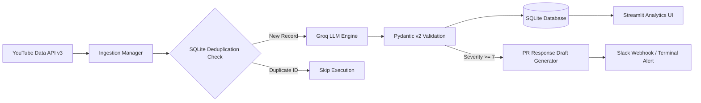

# Brand Sentiment & Crisis Monitoring Dashboard


An automated, end-to-end AI platform that ingests real-time brand telemetry from social video feeds, performs structured sentiment analysis using high-throughput open LLMs via the Groq API, logs telemetry into SQLite with built-in deduplication, and alerts teams to potential PR crises through an interactive Streamlit analytics dashboard.

---

## Architecture Overview



---

## Key Features

* **Live Data Ingestion:** Collects recent video metadata, titles, and public commentary using the YouTube Data API v3.
* **Structured LLM Analysis:** Employs Pydantic v2 schemas and Groq inference (`openai/gpt-oss-20b` / Llama models) to evaluate post sentiment, assign floating-point sentiment scores (-1.0 to +1.0), categorize operational topics, and calculate a severity rating (1 to 10).
* **Data Persistence & Deduplication:** Stores structured records in SQLite via SQLAlchemy ORM, automatically bypassing previously analyzed posts to eliminate redundant API token spend.
* **Automated Crisis Mitigation:** Detects severe negative posts (severity ≥ 7/10) and automatically generates executive PR mitigation statements and webhook notifications.
* **Interactive Analytics UI:** Displays visual metrics, time-series distributions, and category breakdowns via Streamlit and Plotly Express.

---

## Tech Stack

| Component | Technology |
| :--- | :--- |
| **Language** | Python 3.11+ |
| **Frontend / Dashboard** | Streamlit, Plotly Express |
| **LLM Orchestration** | OpenAI Python SDK (configured for Groq API) |
| **Data Validation** | Pydantic v2 |
| **Database & ORM** | SQLite, SQLAlchemy |
| **Ingestion API** | Google API Python Client (`google-api-python-client`) |
| **Environment Management** | `pydantic-settings`, `python-dotenv` |

---

## Directory Structure

```text
brand-sentiment-monitor/
├── config/
│   └── settings.py          # Environment settings management
├── src/
│   ├── agents/
│   │   ├── schemas.py       # Pydantic v2 output structures
│   │   ├── sentiment_agent.py # Groq sentiment classifier
│   │   └── response_agent.py  # PR crisis response generator
│   ├── alerts/
│   │   └── webhook_notifier.py # Slack notification engine
│   ├── database/
│   │   ├── connection.py    # Database connection & session setup
│   │   └── models.py        # SQLAlchemy database models
│   └── ingestion/
│       ├── base.py          # Abstract collector interface
│       ├── youtube_collector.py # YouTube Data API integration
│       └── manager.py       # Aggregator engine
├── .env.example             # Template environment file
├── app.py                   # Streamlit interactive UI
├── README.md                # Project documentation
├── requirements.txt         # Project dependencies
└── run_pipeline.py          # CLI runner for end-to-end processing
```

---

## Getting Started

### Prerequisites

* Python 3.11 or higher
* [YouTube Data API v3 Key](https://console.cloud.google.com/)
* [Groq API Key](https://console.groq.com/)

### Installation

1. **Clone the repository:**
   ```bash
   git clone [https://github.com/your-username/brand-sentiment-monitor.git](https://github.com/your-username/brand-sentiment-monitor.git)
   cd brand-sentiment-monitor
   ```

2. **Create and activate a virtual environment:**
   ```bash
   python -m venv venv
   # On Windows:
   .\venv\Scripts\activate
   # On macOS/Linux:
   source venv/bin/activate
   ```

3. **Install dependencies:**
   ```bash
   pip install -r requirements.txt
   ```

4. **Set up environment variables:**
   ```bash
   cp .env.example .env
   ```
   Open `.env` and configure your keys:
   ```ini
   GROQ_API_KEY=gsk_your_groq_api_key_here
   YOUTUBE_API_KEY=your_youtube_api_key_here
   DATABASE_URL=sqlite:///./sentiment_monitor.db
   SLACK_WEBHOOK_URL=
   ```

---

## Usage

### 1. Run Pipeline via CLI

Execute ingestion and AI analysis directly from your terminal:

```bash
python run_pipeline.py --query "OpenAI" --limit 5
```

### 2. Launch Streamlit Analytics Dashboard

Start the web dashboard to inspect interactive analytics, filter records, and generate live PR mitigation drafts:

```bash
streamlit run app.py
```

---

## License

Distributed under the MIT License. See `LICENSE` for details.